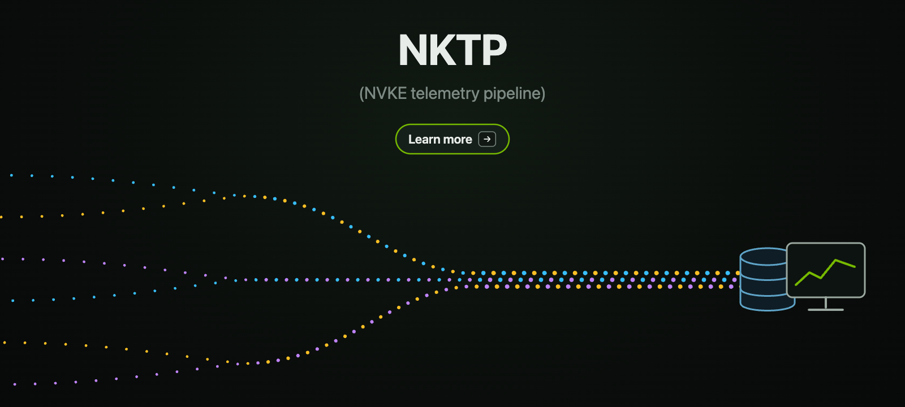

# NVKE Telemetry Pipeline

The NVKE Telemetry Pipeline (NKTP) is an opinionated deployment of OpenTelemetry on Kubernetes. It collects a cluster's metrics, logs, and traces and exports them to the backend you already run, such as Grafana, Datadog, or any OTLP endpoint.

It ships as part of NVKE, and you can also install it on its own on any Kubernetes cluster with Helm.

## Watch the overview

## The problem

OpenTelemetry standardized how telemetry is described and transported. It did not standardize:

- what a Kubernetes cluster should collect,
- how the collectors should be configured to collect it, or
- how to run them reliably as the cluster grows and telemetry volume increases.

As a result, every operator has to build and maintain their own pipeline before they can measure what matters to them, such as SLO attainment, goodput, or mean time between interruptions. On GPU clusters the work is harder still. There is no published default for how GPU metrics and health events should be collected, labeled, and routed, so each team works it out alone.

## What it does

The pipeline installs a fixed, tested set of OpenTelemetry Collectors that:

- **Pull telemetry from the cluster:** node and Kubernetes object metrics, pod logs, and Kubernetes Events.
- **Accept telemetry from workloads:** application metrics, logs, and traces sent over OTLP.
- **Export to your backend:** each signal is buffered and delivered to whatever OTLP-compatible backend you use.

This works on any Kubernetes cluster. On GPU clusters, the pipeline also collects GPU metrics (DCGM) from the NVIDIA GPU Operator and GPU health signals from NVSentinel, so every cluster produces the same signals with the same labels.

## Why it's different

Existing projects each solve part of the problem:

| Option | What it covers | What's missing |
| :-: | :-: | :-: |
| kube-prometheus-stack | Metrics, using Prometheus | Logs and traces |
| OpenTelemetry Operator | Manages individual collectors | How many to run, where to run them, and how they hand data to each other and to a backend |
| opentelemetry-kube-stack | The Operator plus a single collector per node | A topology that holds up at scale |
| Vendor agents | A complete pipeline | Portability, since you're tied to the vendor's distribution |

The NVKE Telemetry Pipeline builds on the OpenTelemetry Operator and fills those gaps with a complete collector topology:

- **A collector on every node** for logs, host metrics, and telemetry pushed by workloads.
- **A shared pool for large cluster-wide scrape targets**, such as kube-state-metrics and the control plane, so they don't overload node collectors.
- **A separate gateway for each signal**, which buffers to disk and retries, so a backend outage doesn't become a gap in your data.
- **A watchdog that reports the pipeline's own health** independently, so you can still diagnose the pipeline when it's failing.

The defaults already reflect scaling tradeoffs that operators would otherwise have to work through themselves. Every collector configuration is still standard OpenTelemetry YAML that you can customize fully.

## Dashboards included

The pipeline includes reference Grafana dashboards. They show how to turn key Kubernetes and GPU signals into views of a cluster's health that are easy to understand and act on.

| Dashboard | What it shows |
| :-: | :-: |
| Cluster Availability | GPU capacity availability and Kubernetes API availability for each cluster |
| Kubernetes Health | Health of the cluster, control plane, nodes, pods, and workloads |
| NVSentinel Latency and Errors | GPU health, node draining, fault quarantine, and NVSentinel's own latency and errors |
| etcd | etcd health, requests, storage, memory, and network traffic |

## Get started

- **Install and operate NKTP:** start with the [chart README](nktp/README.md) for prerequisites and installation, then the [getting-started guide](docs/getting-started.md) for backend configuration and a first look at your telemetry.
- **Send telemetry from your workloads:** read [Send telemetry to NKTP](docs/guides/send_telemetry.md).
- **Customize the pipeline:** see [Add your own blueprints](docs/guides/use_blueprints.md#add-your-own-blueprints) and the [documentation index](docs/README.md) for components and configuration guides.

## Contributing

See the [release process](RELEASING.md) for how chart changes are validated and released.

To contribute, start with [CONTRIBUTING.md](CONTRIBUTING.md); see [GOVERNANCE.md](GOVERNANCE.md) for how decisions are made and [MAINTAINERS.md](MAINTAINERS.md) for who maintains the project. Report security issues through [SECURITY.md](SECURITY.md), not GitHub issues.

## License

NVKE Telemetry Pipeline is licensed under the [Apache License 2.0](LICENSE).

**NOTICE AND DISCLAIMER:** This software automatically retrieves, accesses or
interacts with external materials. Those retrieved materials are not distributed
with this software and are governed solely by separate terms, conditions and
licenses. You are solely responsible for finding, reviewing and complying with
all applicable terms, conditions, and licenses, and for verifying the security,
integrity and suitability of any retrieved materials for your specific use case.
This software is provided "AS IS", without warranty of any kind. The author
makes no representations or warranties regarding any retrieved materials, and
assumes no liability for any losses, damages, liabilities or legal consequences
from your use or inability to use this software or any retrieved materials. Use
this software and the retrieved materials at your own risk.
