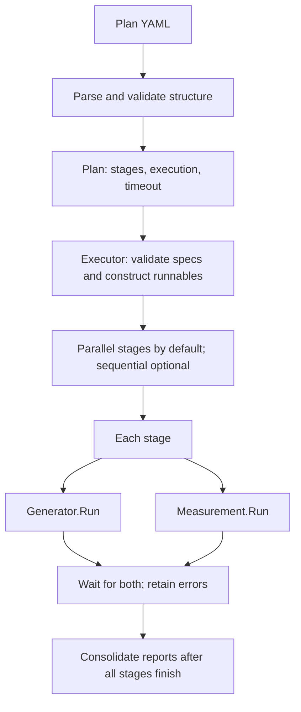

# Scale Tests

Plan-driven testing of NKTP correctness and capacity under telemetry load.
The initial implementation runs no-op generators and measurements. It exercises
parsing, scheduling, cancellation, and report consolidation without requiring a
Kubernetes cluster, creating workloads, or querying telemetry.

## Domain model

| Concept | Meaning |
| --- | --- |
| `Plan` | Named configuration with a timeout, execution mode, and ordered stages. |
| `Stage` | Unique name and one generator/measurement pair. The pair runs concurrently. |
| `ComponentSpec` | Implementation `type` and its implementation-specific `spec`. |
| Generator | Runnable responsible for the complete generation lifetime and resource cleanup. |
| Measurement | Runnable that produces findings and returns an error if execution or checks fail. |
| `measurements.Report` | Measurement-owned structured findings; an empty report is valid. |
| `PlanReport` | Run ID, plan name, and stage reports with component errors, in declaration order. |

The plan contains configuration, not executable objects. `Executor` validates
every component specification and constructs fresh runnables before any stage
starts. Only `type: noop` is supported today, with an empty or omitted `spec`.
No-op implementations return ordinary success and empty measurement reports;
this does not evaluate NKTP correctness or performance.



## Basic configuration

The following plan runs two independent stages concurrently:

```yaml
name: harness-smoke
execution: parallel
timeout: 1m
stages:
  - name: baseline
    generator:
      type: noop
      spec: {}
    measurement:
      type: noop
      spec: {}
  - name: second-stage
    generator:
      type: noop
      spec: {}
    measurement:
      type: noop
      spec: {}
```

This example is available at [plans/noop.yaml](plans/noop.yaml). Omitted
`execution` defaults to `parallel`. Set it to `sequential` to finish each stage
before starting the next; the generator and measurement still run concurrently
within each stage. A positive `timeout` and unique, nonempty stage names are
required. Unknown envelope fields, duplicate keys, and multiple YAML documents
are rejected by the parser. Implementation names and specs are checked by the
executor before any runnable starts.

## Running

From the repository root:

```sh
task test:scale
task test:scale -- -plan "$PWD/tests/scale/plans/noop.yaml"
```

Or from `tests/`:

```sh
go test -tags scale -count=1 -v -timeout=5m -run '^TestRun$' ./scale
go test -race -count=1 ./...
```

`tests/scale/main_test.go` is the build-tagged entrypoint. It loads the plan and
calls `runner.Executor.Execute`. Plan paths are absolute or relative to
`tests/scale`, the Go test's working directory. The executor uses Go's default
`slog` logger to log each stage's completion and then the plan's completion, with
plan name, run ID, and errors. Consolidated stage reports are logged by the test
after execution. Any returned error fails the test and command.

## Execution and extension

The [pkg](pkg) directory contains the `runner` Go package within `tests/go.mod`.
`plan.go` owns configuration and parsing; `executor.go` owns consumer-defined
runnable interfaces, scheduling, and consolidated reports. `components.go` selects
constructors and delegates spec validation to them.

Concrete generators live in [pkg/generators](pkg/generators), and concrete
measurements live in [pkg/measurements](pkg/measurements). Each package's `noop.go`
provides a `Noop` implementation, a `NewNoop` constructor, and private spec
validation as the example for future implementations: validate the spec before
returning a runnable, without acquiring resources.

`measurements.Report` holds the measurement's findings; `StageReport` and
`PlanReport` stay with the executor. Both implementation packages satisfy the
executor's interfaces without importing the runner package. `main_test.go`
imports `tests/scale/pkg` as `runner`.

A component error cancels its peer in the same stage. Other stages continue,
including later sequential stages. Successful completion does not cancel a peer.
Plan timeout or caller cancellation stops active work and prevents unstarted
components from running. Their report entries contain cancellation errors.
Partial reports are retained, and report order is independent of completion order.

Every runnable must honor its context and finish its goroutines and bounded
cleanup before returning, including after partial startup. The executor waits
for these returns; cancellation cannot forcibly stop an uncooperative runnable.
Constructors must acquire no resources. Measurements must finish modifying their
reports before returning them.

Telemetrygen and PromQL support can add concrete implementations whose
constructors decode and validate their own specs, then add entries to the
constructor switches. A generator's `Run` must cover the
whole workload lifetime, not just Job submission. Generation duration, observation
windows, and readiness requirements belong to those implementations: concurrent
launch does not imply readiness. Cluster access and provisioning are not part of
the current no-op implementation.
