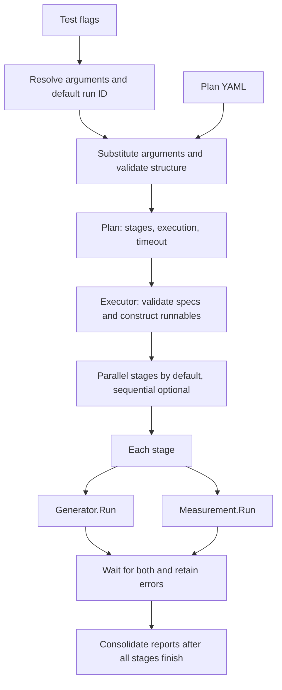

# Scale Tests

Plan-driven testing of NKTP correctness and capacity under telemetry load.
The harness runs no-op components without a cluster, or finite binary workloads
through the Kubernetes Job generator. The Kubernetes emulator creates temporary
KWOK nodes with configured capacity. Measurements support no-op observations and
Prometheus queries. Query reports collect data without performance pass/fail
verdicts. Successful Job execution alone does not verify backend delivery or NKTP
performance.

For the mixed 100M Avalanche workload with node-local and large-target scraping,
see the [Avalanche 100M guide](avalanche-100m.md).

For 10,000 real Pods with continuous replacement, see the
[Pod churn guide](10k-pods.md).

For Kubernetes Event load through the scale harness, see the
[kube-burner plan and profile](kube-burner-events.md).

For metrics, stdout logs, spans, Events and large-target load together, see the
[mixed workload guide](mixed-workload.md).

## Setup

Requires kubectl, Helm 3 or 4, Task, and Go. Local provisioning also requires
Docker and Kind. Run commands from the repository root.

Create a local cluster:

```sh
export KUBECONFIG="$(task --silent scale:up)"
```

For an existing cluster, authenticate with its provider and select its kubeconfig:

```sh
export KUBECONFIG=/absolute/path/to/kubeconfig
```

Install the test environment, then run a plan:

```sh
task scale:install
task scale:test -- -plan "$PWD/tests/scale/plans/telemetrygen.yaml"
```

`scale:up` only provisions the local cluster and prints its kubeconfig path.
`scale:install` sets up cert-manager and its CRDs, KWOK, and NKTP in the selected
cluster.
It waits for readiness and forwards [Prometheus](http://127.0.0.1:9090) and
[Grafana](http://127.0.0.1:3000). Keep both local ports free. Tests use the
kubeconfig's current context and clean up their generated workloads.
For runs longer than the default 12 minutes, set `TEST_TIMEOUT=30m` before `--`
with enough time for the plan and cleanup.

Use `HELM_VALUES_FILE` for the environment configuration. Paths are relative to
the repository root. Supply the file on each `task scale:install` run to retain
the configuration. Installation creates or upgrades the `nktp` Helm release.
For existing clusters, configure reuse of compatible shared components in this file.

`INSTALL_KWOK` defaults to `true` for installation and uninstallation. Set it to
`false` on both commands when KWOK is shared or not needed for the selected plans.

Run `task scale:uninstall` explicitly to remove NKTP and stop its forwards.
With `INSTALL_KWOK=true`, it also removes the KWOK releases and completion policy.
It preserves cert-manager, the cluster and kubeconfig and is never invoked by
another task.
`task scale:down` deletes only the local scale Kind cluster and its kubeconfig,
even when another `KUBECONFIG` is exported. Save observations before cleanup
because LGTM storage is temporary. Failed setup leaves resources for inspection.

Label emulated pods `scale.nktp.io/lifecycle: complete-30s` to complete them after
30 seconds of Running time. Controller delays may extend their lifetime.
Pods without the lifecycle label use KWOK's default behavior.

## Stdout log generation

The [stdout logs plan](stdout-logs.md) runs 94 Vector Pods per worker on 100 nodes,
generating about 4 GiB/hour of log bodies per node through the node collectors
and logs gateways.

## Watchdog load

The [watchdog plan](watchdog.md) runs 5,000 sources, each sending 100 metric
points and 100 log records per minute with 100 KiB log bodies.

## Domain model

| Concept | Meaning |
| --- | --- |
| `Plan` | Named configuration with a timeout, execution mode, and ordered stages. |
| `Stage` | Unique name and one generator/measurement pair. The pair runs concurrently. |
| `ComponentSpec` | Implementation `type` and its implementation-specific `spec`. |
| Generator | Runnable responsible for the complete generation lifetime and resource cleanup. |
| Measurement | Runnable that produces findings and returns an error if execution or checks fail. |
| `measurements.Report` | Measurement-owned structured findings. An empty report is valid. |
| `PlanReport` | Run ID, plan name, and stage reports with component errors, in declaration order. |

The plan contains configuration, not executable objects. `Executor` validates
every component specification and constructs fresh runnables before any stage
starts. Generators support `type: noop`, `type: job`, `type: pod`,
`type: statefulset` and `type: kubernetes`.
Measurements support `type: noop` and `type: prometheus`. No-op components accept an empty or omitted
`spec`. No-op measurements also accept `spec.queries`, a mapping of names to nonempty query
strings. These strings are resolved by the plan parser but are not evaluated.
No-op components return ordinary success and empty measurement reports. This
does not evaluate NKTP correctness or performance.



## Basic configuration

The following plan runs two independent stages concurrently:

```yaml
name: harness-smoke
execution: parallel
timeout: 1m
stages:
  - name: baseline
    generator:
      type: noop
      spec: {}
    measurement:
      type: noop
      spec: {}
  - name: second-stage
    generator:
      type: noop
      spec: {}
    measurement:
      type: noop
      spec: {}
```

This example is available at [plans/noop.yaml](plans/noop.yaml). Omitted
`execution` defaults to `parallel`. Set it to `sequential` to finish each stage
before starting the next. The generator and measurement still run concurrently
within each stage. A positive `timeout` and unique, nonempty stage names are
required. Unknown envelope fields, duplicate envelope keys, and multiple YAML
documents are rejected by the parser. Implementation names and specs are checked by the
executor before any runnable starts.

## Running

Run a plan against the installed environment. `task tests:scale` is an alias for
`task scale:test`:

```sh
task scale:test -- -plan "$PWD/tests/scale/plans/telemetrygen.yaml"
```

The default kubeconfig is `tests/scale/.kubeconfig`, created by `scale:up` for
context `kind-nktp-scale`.
To use another cluster:

```sh
task scale:test KUBECONFIG=/absolute/path/to/kubeconfig -- -plan "$PWD/tests/scale/plans/telemetrygen.yaml"
```

Override the default with the Task variable `KUBECONFIG` before `--`, an
environment variable, or `-kubeconfig PATH` after `--`. Prefer absolute paths.
Relative Task values resolve from the repository root. Relative paths passed
through `-kubeconfig` resolve from `tests/scale`. Kubeconfig file lists are rejected.

No-op plans do not require a kubeconfig or cluster:

```sh
task scale:test
task scale:test -- -plan "$PWD/tests/scale/plans/noop.yaml"
```

Or from `tests/`:

```sh
go test -tags scale -count=1 -v -timeout=12m -run '^TestRun$' ./scale
go test -race -tags scale -count=1 ./...
```

`tests/scale/main_test.go` is the build-tagged entrypoint. It resolves arguments,
loads the plan and calls `runner.Executor.Execute`. Plan paths are absolute or relative to
`tests/scale`, the Go test's working directory. The executor uses Go's default
`slog` logger to log each stage's start and completion, then the plan's completion,
with plan name, run ID, and errors. Consolidated stage reports are printed after
execution, with summary statistics and numeric histogram counts for each query
result series. Any returned error fails the test and command.

## Arguments and attribution

Scale tests can send telemetry to the same backend as other tests or earlier
runs. Attribution lets you distinguish one run's metrics, logs and traces from
that other traffic. Use the same run ID in generator attributes and measurement
queries to select the intended test data.

Plans are Go `text/template` templates. Use `{{ .Args.name }}` to make a value
configurable. For example, in your plan's Job spec:

```yaml
podTemplate:
  spec:
    containers:
      - name: generator
        image: example/telemetrygen:version
        args:
          - "--rate={{ .Args.rate }}"
          - "--duration={{ .Args.duration }}"
          - '--telemetry-attributes=test_run_id="{{ .Args.runId }}"'
```

Run that plan from the repository root, supplying values with repeated
`-arg NAME=VALUE` flags:

```sh
task scale:test -- -plan /absolute/path/to/plan.yaml \
  -arg rate=100 \
  -arg duration=3m \
  -arg run-id=ci-123
```

Supply each referenced argument once, except `run-id`, which is generated when
omitted. Other missing arguments and duplicate assignments fail the command.
Argument names start with an ASCII letter and may contain letters, digits,
underscores, and single hyphens. Hyphenated command-line names become camel case
in templates: `sample-rate` becomes `.Args.sampleRate` and `run-id` becomes
`.Args.runId`. Names that normalize to the same template key are duplicates.

Omit `-arg run-id=...` to get a fresh random ID for each run, shown in the test
output. Supply your own ID to associate a run with a CI job or another external
reference. Use 1 to 63 ASCII letters, digits, underscores, hyphens or dots, with a
letter or digit at each end. Use a different ID for each run you want to
distinguish.

Reference `{{ .Args.runId }}` in query filters too, for example
`count({test_run_id="{{ .Args.runId }}"})`. The
[telemetrygen plan](plans/telemetrygen.yaml) includes examples for metrics, logs
and traces. The metrics stage executes PromQL queries against the in-cluster
Prometheus. The logs and traces stages retain no-op query examples.

Quote references that should remain strings, as in the YAML example. Escape
supplied values for the surrounding YAML and query syntax. To include the
literal text `{{ .Args.name }}`, write `{{ "{{ .Args.name }}" }}`.

## Prometheus measurements

Prometheus measurements collect metrics through PromQL queries during a load test
and summarize the results without performance pass/fail thresholds.

```yaml
measurement:
  type: prometheus
  spec:
    endpoint: http://127.0.0.1:9090
    duration: 3m
    interval: 15s
    query_timeout: 10s
    measurements:
      - name: run_series
        units: series
        query: count({test_run_id="{{ .Args.runId }}"})
      - name: throughput
        units: points/s
        query: sum(rate(otelcol_exporter_sent_metric_points_total{job="nktp-gateway-metrics"}[2m]))
      - name: queue
        units: bytes
        query: otelcol_exporter_queue_size{job="nktp-gateway-metrics",data_type="metrics"}
```

The [telemetrygen plan](plans/telemetrygen.yaml) measures series from the current
run, plus pipeline throughput, queues, and memory across all traffic.

An `endpoint`, a positive `duration`, and at least one named query are required.
`interval` defaults to `15s` and `query_timeout` to `10s`. Each entry in the
`measurements` list contains a unique `name`, a required `query`, and optional
`units` for display, with automatic scaling for `bytes` and `bytes/s`. Multiline
queries can use YAML block scalars. No-op measurements accept the same entries
as unevaluated examples.

`task scale:install` makes Prometheus available at the example endpoint. For
another environment, use an endpoint reachable from the test host.

Collection starts with the stage, querying at `interval`, and ends normally after
`duration`. Query failures before that deadline fail the run and preserve results
collected so far. The stage waits for both collection and load generation to
finish. The test report shows statistics and histograms for each query and label
set, with missing data and errors shown separately.

## Execution and extension

The [pkg](pkg) directory contains the `runner` Go package within `tests/go.mod`.
`plan.go` owns configuration and parsing. `arguments.go` resolves invocation
flags. `executor.go` owns consumer-defined runnable interfaces, scheduling,
and consolidated reports. `components.go` selects
constructors and delegates spec validation to them.

Concrete generators live in [pkg/generators](pkg/generators), and concrete
measurements live in [pkg/measurements](pkg/measurements). Each package's `noop.go`
provides a `Noop` implementation, a `NewNoop` constructor, and private spec
validation as the example for future implementations: validate the spec before
returning a runnable, without acquiring resources.

`measurements.Report` holds the measurement's findings. `StageReport` and
`PlanReport` stay with the executor. Both implementation packages satisfy the
executor's interfaces without importing the runner package. `main_test.go`
imports `tests/scale/pkg` as `runner`.

A component error cancels its peer in the same stage. Other stages continue,
including later sequential stages. Successful completion does not cancel a peer.
Plan timeout or caller cancellation stops active work and prevents unstarted
components from running. Their report entries contain cancellation errors.
Partial reports are retained, and report order is independent of completion order.

Every runnable must honor its context and finish its goroutines and bounded
cleanup before returning, including after partial startup. The executor waits
for these returns. Cancellation cannot forcibly stop an uncooperative runnable.
Constructors must acquire no resources. Measurements must finish modifying their
reports before returning them.

The harness can be extended with additional generators and measurements.

## Available generators

- **No-op (`noop`)** exercises the harness without generating load or requiring a
  cluster. See the [no-op plan](plans/noop.yaml).
- **Kubernetes Pod (`pod`)** runs a batch of native Pod templates on real or
  emulated nodes. See the [KWOK Pod plan](plans/kwok-pods.yaml).
- **Kubernetes Job (`job`)** runs a containerized load generator to completion.
  See the [telemetrygen plan](plans/telemetrygen.yaml).
- **Kubernetes StatefulSet (`statefulset`)** runs long-lived replicas with stable
  Pod names. See the [Avalanche plan](plans/avalanche.yaml).
- **Kubernetes emulator (`kubernetes`)** creates KWOK nodes, holds them while
  measurements run, then deletes them. See the [node plan](plans/kwok-nodes.yaml).

For `pod`, `job` and `statefulset`, `count` sets how many workload objects to create.
It defaults to one, accepts zero to create nothing and must be a nonnegative integer.
Job `parallelism` and StatefulSet `replicas` control Pods per object.
Multiple Jobs and StatefulSets run concurrently. A failure cancels the others
and waits for their cleanup.

The telemetrygen plan uses namespace `nktp` and the NKTP services installed by
`task scale:install`. When using another cluster, adjust the plan namespace and
endpoints as needed. The test harness itself does not provision a cluster.

**Jobs and pods are cleaned up before the test returns**, including after failure
or cancellation. Workload and cleanup errors fail the test.

## Jobs

The Job generator runs a finite workload from a native Kubernetes Pod template.
The [telemetrygen example](plans/telemetrygen.yaml) sends metrics, logs and traces
to the NKTP collectors.

```yaml
generator:
  type: job
  spec:
    count: 2
    parallelism: 3
    podTemplate:
      metadata:
        namespace: nktp
        labels:
          run_id: '{{ .Args.runId }}'
      spec:
        containers:
        - name: load
          image: ghcr.io/open-telemetry/opentelemetry-collector-contrib/telemetrygen:v0.159.0
          command: [/telemetrygen]
          args:
          - metrics
          - --otlp-endpoint=nktp-gateway-metrics-collector.nktp.svc:4317
          - --otlp-insecure
          - --duration=1m
          - --rate=10
```

`parallelism` limits concurrent Pods per Job and defaults to one. `completions`
sets successful Pods required per Job and defaults to `parallelism`. Both must be
positive. Set `completions` higher to replace successful Pods until that total is
reached. The namespace comes from `podTemplate.metadata.namespace`, defaults to
`default`, and must already exist.
The generator uses the plan's kubeconfig. The optional `context` selects a context
in that file. The run succeeds when every Job completes. The plan timeout bounds
scheduling and execution. Failed Jobs are not retried.

Use binaries that exit successfully within the plan timeout. Restart policy
defaults to `Never`, and service-account token mounting defaults to false.
By default, each Job spreads Pods evenly across eligible nodes. Pods wait when
the spread constraint cannot be satisfied. Explicit native Pod settings,
including resources and scheduling constraints, are preserved. Names and the
`scale.nktp.io/generator` label are assigned per run. Job controller labels and
the ownership label are reserved. The Job and its Pods are cleaned up on
completion, failure or cancellation.

## KWOK nodes

The Kubernetes emulator creates temporary nodes in named groups, each with its
own Kubernetes node template. KWOK simulates their capacity without allocating
real CPUs or memory.

```yaml
generator:
  type: kubernetes
  spec:
    duration: 10m
    nodeGroups:
      - name: workers
        replicas: 1000
        nodeTemplate:
          metadata:
            labels:
              run_id: '{{ .Args.runId }}'
          status:
            capacity:
              cpu: "96"
              memory: 384Gi
              pods: "110"
```

Each group defaults to 1,000 replicas. `nodeTemplate` uses native Kubernetes Node
fields for labels, annotations, spec and status. Set CPU, memory and pod capacity
in `status.capacity`. Other resources, such as `nvidia.com/gpu`, are also supported.
Allocatable resources default to capacity. Add groups with different templates to
represent different node types or zones.

The generator uses the plan's kubeconfig. It waits for all groups to become Ready,
keeps them available for `duration`, then removes them. Duration must be positive.
Cleanup also runs after failure or cancellation. Nodes are removed concurrently,
with a separate cleanup timeout that grows with the number of nodes. Cleanup
failures are reported alongside run failures. This generator creates nodes only.

Kubernetes validates the node templates when they are created. Replica counts
include only generated nodes. The real Kind nodes remain in the cluster, so the
total node count will be higher.

The [example plan](plans/kwok-nodes.yaml) uses this configuration. From the
repository root:

```sh
export KUBECONFIG="$(task --silent scale:up)"
task scale:install
task scale:test TEST_TIMEOUT=40m -- -plan "$PWD/tests/scale/plans/kwok-nodes.yaml"
```

The test timeout allows for the plan deadline and cleanup. Increase it when
using larger groups or a longer plan timeout.

## Pods

The Pod generator runs a finite batch from a native Kubernetes Pod template.
The [KWOK example](plans/kwok-pods.yaml) simulates 1,000 Pods that complete after
30 seconds of Running time.

```yaml
generator:
  type: pod
  spec:
    count: 1000
    podTemplate:
      metadata:
        labels:
          run_id: '{{ .Args.runId }}'
          scale.nktp.io/lifecycle: complete-30s
      spec:
        restartPolicy: Never
        nodeSelector:
          run_id: '{{ .Args.runId }}'
        tolerations:
        - key: kwok.x-k8s.io/node
          operator: Equal
          value: fake
          effect: NoSchedule
        containers:
        - name: load
          image: registry.k8s.io/pause:3.10
          resources:
            requests:
              cpu: 100m
              memory: 128Mi
```

`task scale:install` installs KWOK and the completion policy. Target KWOK nodes must
have the matching `run_id` label and enough capacity for the requested Pods.
Use the same kubeconfig and run ID for the node and Pod generators:

```sh
task scale:test TEST_TIMEOUT=30m -- -plan "$PWD/tests/scale/plans/kwok-pods.yaml" -arg run-id=example-run
```

The test timeout allows for the plan's 20-minute deadline and cleanup.

`count` defaults to one, and zero creates no Pods. The namespace comes from
`podTemplate.metadata.namespace`, defaults to `default`, and must already exist.
Pods start as scheduling permits, including when nodes become available later.
The run succeeds when all Pods succeed. Failure, disappearance or plan timeout
fails the run. Pods are created once and are not replaced. Names and the
`scale.nktp.io/generator` label are assigned for cleanup.

KWOK simulates the lifecycle without executing the image. To run a real load
binary, remove the KWOK lifecycle label, selector and toleration, then set the
container image, command and arguments. The binary must exit successfully within
the plan timeout. All other native template settings are preserved.

## StatefulSets

The StatefulSet generator runs long-lived replicas from a native Kubernetes Pod
template. It keeps each replica's name when Kubernetes replaces its Pod.

```yaml
generator:
  type: statefulset
  spec:
    count: 2
    replicas: 3
    duration: 3m
    podTemplate:
      metadata:
        namespace: nktp
        labels:
          run_id: '{{ .Args.runId }}'
      spec:
        containers:
        - name: load
          image: registry.k8s.io/pause:3.10
```

Replicas default to one, and zero creates no resources. The namespace comes from
`podTemplate.metadata.namespace`, defaults to `default`, and must already exist.
`duration` must be positive. Each StatefulSet starts its own duration when all
its replicas first become Ready. The run succeeds when every StatefulSet finishes
its duration and is Ready again. Replacement does not restart a set's timer.
The plan timeout bounds startup and recovery as well as the configured duration.

Kubernetes restarts containers and replaces deleted Pods. Use long-lived binaries
with the StatefulSet's required `Always` restart policy. Native Pod settings,
including readiness probes, resource requests and scheduling, come from the
template. Names and the `scale.nktp.io/generator` label are assigned per run.
The StatefulSet, its Pods and its headless Service are cleaned up on completion,
failure or cancellation. Stable replica names apply within a run.

## Avalanche

[Avalanche](https://github.com/prometheus-community/avalanche) generates
Prometheus metrics for NKTP to scrape. The [example plan](plans/avalanche.yaml)
runs three StatefulSet replicas for three minutes after readiness. Each replica
serves 10,000 gauge series. The [scrape profile](scale-test-values.yaml) routes
Avalanche targets through NKTP's large-target collectors and metrics gateway to
the blackhole collectors.

From the repository root:

```sh
task scale:install HELM_VALUES_FILE="$PWD/tests/scale/scale-test-values.yaml"
task scale:test -- -plan "$PWD/tests/scale/plans/avalanche.yaml"
```

Pass the values file on subsequent `scale:install` runs to keep the scrape profile.
The plan and profile use namespace `nktp`. Adjust both when using another namespace.

Adjust `replicas`, `duration` or the container arguments to change the load.
The Pod name supplies Avalanche's `generator_instance` label, so that label
survives replacement of a replica. Other scrape labels can still change.
The measurement is no-op, so success confirms workload readiness and cleanup
without verifying backend delivery or complete time-series identity.

## Continuous metrics load

[plans/metrics-1m.yaml](plans/metrics-1m.yaml) runs upstream Avalanche and
telemetrygen concurrently in the kind cluster for ten minutes. It targets
approximately **1 million distinct series offered per rolling 60-second window**
after startup.

| Generator | Workloads | Delivery to NKTP | Target series per window |
| --- | --- | --- | --- |
| Avalanche | 1 Job with 5 pods, each serving 100,000 series | Two large-target collectors scrape every 15 seconds | 500,000 |
| telemetrygen | 1 Job with 3 pods, each running 128 workers | Continuous OTLP stream of new series | About 507,000 |

From the repository root:

```sh
task scale:install HELM_VALUES_FILE="$PWD/tests/scale/scale-test-values.yaml"
task scale:test -- -plan "$PWD/tests/scale/plans/metrics-1m.yaml"
```

[plans/metrics-2m.yaml](plans/metrics-2m.yaml) doubles the offered load to about
2 million series per rolling 60-second window using 10 Avalanche pods and
6 telemetrygen pods. It uses the same ten-minute duration and scale profile.

```sh
task scale:test -- -plan "$PWD/tests/scale/plans/metrics-2m.yaml"
```

The [scale profile](scale-test-values.yaml) runs two blackhole collectors that
accept and discard traffic from all three gateways. Watchdog keeps component and
producer observations in LGTM. Generator pods spread evenly across the three
kind workers.

The report covers resource use, gateway and blackhole throughput, queues and
scrape health. Compare results after all generators have started and produced
traffic for at least one minute. Jobs and pods are cleaned up automatically.

Limitations:

- The target is approximate and received unique-series counts are not verified.
  Generated telemetry is discarded. Series-count queries in other plans require
  the normal LGTM setup without this profile.
- Throughput counters include background traffic and may include retries. Run
  one load test at a time when comparing the measurements with the target.
- Watchdog outages can cause missing scrape diagnostics and collection errors.
- All kind nodes share the Docker VM's resources. Even placement adds no CPU or
  memory. The blackhole also consumes resources and can limit throughput.
  A measurement timeout stops its paired generator.
- Spreading balances pod counts, not resource use. Insufficient capacity can
  leave pods Pending, and node failures do not trigger automatic rebalancing.
- Telemetrygen's [upstream throughput issue](https://github.com/open-telemetry/opentelemetry-collector-contrib/issues/49950)
  can reduce the load during a run.
- Telemetrygen must connect directly to the metrics gateway with its source
  address preserved. An intermediary that hides client addresses can merge
  identities. Pod replacement or address reuse can also distort the load.
