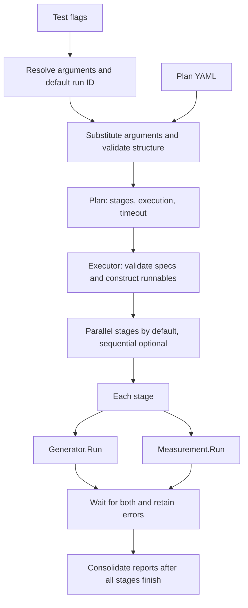

# Scale Tests

Plan-driven testing of NKTP correctness and capacity under telemetry load.
The harness runs no-op components without a cluster, or finite binary workloads
through the Kubernetes Job generator. Measurements support no-op observations and
Prometheus queries. Query reports collect data without performance pass/fail
verdicts. Successful Job execution alone does not verify backend delivery or NKTP
performance.

## Local cluster

Requires Docker, Kind, kubectl, Helm, and Task. From the repository root:

```sh
task scale:up
task scale:down
```

`scale:up` creates `nktp-scale` with the [dedicated Kind config](kind-config.yaml)
if needed, then installs or upgrades the NKTP Helm release in namespace `nktp`
from the local chart. It prepares chart dependencies and waits for nodes and NKTP
workloads, including workloads created by the Operator. Each readiness wait has a
five-minute timeout. Workload readiness does not verify telemetry delivery.
Chart dependencies are downloaded only when missing or invalid. Once workloads
are ready, `scale:up` starts a background port-forward from `127.0.0.1:9090` to
Prometheus in `service/lgtm`. Keep local port 9090 free. Repeating `scale:up`
restarts the forward. Its log is `tests/scale/.prometheus-port-forward.log`.

Use `HELM_VALUES_FILE=/absolute/path/to/values.yaml` to supply Helm values.
Relative paths are resolved from `tests/scale/`. Each run applies the current
chart defaults and the supplied values file. Pass the file on every run that
needs it. Omitting it restores chart defaults. Tilt is not required.

Run `scale:up` again to apply local chart or values changes to the existing
cluster. Kind configuration changes require `scale:down` followed by `scale:up`.
Failed setup leaves the cluster for inspection. After correcting the problem,
retry `scale:up` or run `scale:down` followed by `scale:up` for a fresh cluster.

Scale commands use only `tests/scale/.kubeconfig` and the `kind-nktp-scale`
context. For manual access:

```sh
export KUBECONFIG="$PWD/tests/scale/.kubeconfig"
```

`scale:down` stops the managed port-forward, then deletes the scale cluster and
its kubeconfig. It does not stop the dev Tilt session or delete the dev cluster.
The no-op plans below do not require `scale:up`.

## Domain model

| Concept | Meaning |
| --- | --- |
| `Plan` | Named configuration with a timeout, execution mode, and ordered stages. |
| `Stage` | Unique name and one generator/measurement pair. The pair runs concurrently. |
| `ComponentSpec` | Implementation `type` and its implementation-specific `spec`. |
| Generator | Runnable responsible for the complete generation lifetime and resource cleanup. |
| Measurement | Runnable that produces findings and returns an error if execution or checks fail. |
| `measurements.Report` | Measurement-owned structured findings. An empty report is valid. |
| `PlanReport` | Run ID, plan name, and stage reports with component errors, in declaration order. |

The plan contains configuration, not executable objects. `Executor` validates
every component specification and constructs fresh runnables before any stage
starts. Generators support `type: noop` and `type: job`. Measurements support
`type: noop` and `type: prometheus`. No-op components accept an empty or omitted
`spec`. No-op measurements also accept `spec.queries`, a mapping of names to nonempty query
strings. These strings are resolved by the plan parser but are not evaluated.
No-op components return ordinary success and empty measurement reports. This
does not evaluate NKTP correctness or performance.



## Basic configuration

The following plan runs two independent stages concurrently:

```yaml
name: harness-smoke
execution: parallel
timeout: 1m
stages:
  - name: baseline
    generator:
      type: noop
      spec: {}
    measurement:
      type: noop
      spec: {}
  - name: second-stage
    generator:
      type: noop
      spec: {}
    measurement:
      type: noop
      spec: {}
```

This example is available at [plans/noop.yaml](plans/noop.yaml). Omitted
`execution` defaults to `parallel`. Set it to `sequential` to finish each stage
before starting the next. The generator and measurement still run concurrently
within each stage. A positive `timeout` and unique, nonempty stage names are
required. Unknown envelope fields, duplicate envelope keys, and multiple YAML
documents are rejected by the parser. Implementation names and specs are checked by the
executor before any runnable starts.

## Running

From the repository root, run the telemetrygen plan against the default scale
Kind cluster:

```sh
task scale:up
task test:scale -- -plan "$PWD/tests/scale/plans/telemetrygen.yaml"
task scale:down
```

The default kubeconfig is `tests/scale/.kubeconfig`, created by `scale:up` for
context `kind-nktp-scale`. To use another cluster:

```sh
task test:scale KUBECONFIG=/absolute/path/to/kubeconfig -- -plan "$PWD/tests/scale/plans/telemetrygen.yaml"
```

Override the default with the Task variable `KUBECONFIG` before `--`, an
environment variable, or `-kubeconfig PATH` after `--`. The forwarded form
`-plan PATH KUBECONFIG=/absolute/path/to/kubeconfig` also works. A trailing
assignment takes precedence over `-kubeconfig`, which overrides the Task or
environment default. Prefer absolute paths for overrides. Relative paths
resolve from `tests/scale`. Kubeconfig file lists are rejected.

No-op plans do not require a kubeconfig or cluster:

```sh
task test:scale
task test:scale -- -plan "$PWD/tests/scale/plans/noop.yaml"
```

Or from `tests/`:

```sh
go test -tags scale -count=1 -v -timeout=5m -run '^TestRun$' ./scale
go test -race -tags scale -count=1 ./...
```

`tests/scale/main_test.go` is the build-tagged entrypoint. It resolves arguments,
loads the plan and calls `runner.Executor.Execute`. Plan paths are absolute or relative to
`tests/scale`, the Go test's working directory. The executor uses Go's default
`slog` logger to log each stage's start and completion, then the plan's completion,
with plan name, run ID, and errors. Consolidated stage reports are printed after
execution, with summary statistics and numeric histogram counts for each query
result series. Any returned error fails the test and command.

## Arguments and attribution

Scale tests can send telemetry to the same backend as other tests or earlier
runs. Attribution lets you distinguish one run's metrics, logs and traces from
that other traffic. Use the same run ID in generator attributes and measurement
queries to select the intended test data.

Use `{{args.name}}` to make a value configurable. For example, in your plan's
Job spec:

```yaml
args:
  - "--rate={{args.rate}}"
  - "--duration={{args.duration}}"
  - '--telemetry-attributes=test_run_id="{{args.run-id}}"'
```

Run that plan from the repository root, supplying values with repeated
`-arg NAME=VALUE` flags:

```sh
task test:scale -- -plan /absolute/path/to/plan.yaml \
  -arg rate=100 \
  -arg duration=3m \
  -arg run-id=ci-123
```

Supply each referenced argument once, except `run-id`, which is generated when
omitted. Other missing arguments and duplicate assignments fail the command.
Argument names start with an ASCII letter and may contain
letters, digits, underscores and hyphens.

Omit `-arg run-id=...` to get a fresh random ID for each run, shown in the test
output. Supply your own ID to associate a run with a CI job or another external
reference. Use 1 to 63 ASCII letters, digits, underscores, hyphens or dots, with a
letter or digit at each end. Use a different ID for each run you want to
distinguish.

Reference `{{args.run-id}}` in query filters too, for example
`count({test_run_id="{{args.run-id}}"})`. The
[telemetrygen plan](plans/telemetrygen.yaml) includes examples for metrics, logs
and traces. The metrics stage executes PromQL queries against the in-cluster
Prometheus. The logs and traces stages retain no-op query examples.

Quote references that should remain strings, as in the YAML example. Escape
supplied values for the surrounding YAML and query syntax. To include the
literal text `{{args.name}}`, write `{{{{args.name}}`.

## Prometheus measurements

Prometheus measurements collect metrics through PromQL queries during a load test
and summarize the results without performance pass/fail thresholds.

```yaml
measurement:
  type: prometheus
  spec:
    endpoint: http://127.0.0.1:9090
    duration: 3m
    interval: 15s
    query_timeout: 10s
    units:
      run_series: series
      throughput: points/s
      queue: bytes
    queries:
      run_series: 'count({test_run_id="{{args.run-id}}"})'
      throughput: 'sum(rate(otelcol_exporter_sent_metric_points_total{job="nktp-gateway-metrics"}[2m]))'
      queue: 'otelcol_exporter_queue_size{job="nktp-gateway-metrics",data_type="metrics"}'
```

The [telemetrygen plan](plans/telemetrygen.yaml) measures series from the current
run, plus pipeline throughput, queues, and memory across all traffic.

An `endpoint`, a positive `duration`, and at least one named query are required.
`interval` defaults to `15s` and `query_timeout` to `10s`. Optional `units` labels
results by query name, with automatic scaling for `bytes` and `bytes/s`.

For the scale Kind cluster, `task scale:up` makes Prometheus available at the
example endpoint. For another environment, use an endpoint reachable from the
test host.

Collection starts with the stage, querying at `interval`, and ends normally after
`duration`. Query failures before that deadline fail the run and preserve results
collected so far. The stage waits for both collection and load generation to
finish. The test report shows statistics and histograms for each query and label
set, with missing data and errors shown separately.

## Execution and extension

The [pkg](pkg) directory contains the `runner` Go package within `tests/go.mod`.
`plan.go` owns configuration and parsing. `arguments.go` resolves invocation
flags. `executor.go` owns consumer-defined runnable interfaces, scheduling,
and consolidated reports. `components.go` selects
constructors and delegates spec validation to them.

Concrete generators live in [pkg/generators](pkg/generators), and concrete
measurements live in [pkg/measurements](pkg/measurements). Each package's `noop.go`
provides a `Noop` implementation, a `NewNoop` constructor, and private spec
validation as the example for future implementations: validate the spec before
returning a runnable, without acquiring resources.

`measurements.Report` holds the measurement's findings. `StageReport` and
`PlanReport` stay with the executor. Both implementation packages satisfy the
executor's interfaces without importing the runner package. `main_test.go`
imports `tests/scale/pkg` as `runner`.

A component error cancels its peer in the same stage. Other stages continue,
including later sequential stages. Successful completion does not cancel a peer.
Plan timeout or caller cancellation stops active work and prevents unstarted
components from running. Their report entries contain cancellation errors.
Partial reports are retained, and report order is independent of completion order.

Every runnable must honor its context and finish its goroutines and bounded
cleanup before returning, including after partial startup. The executor waits
for these returns. Cancellation cannot forcibly stop an uncooperative runnable.
Constructors must acquire no resources. Measurements must finish modifying their
reports before returning them.

The harness can be extended with additional generators and measurements.

## Available generators

- **No-op (`noop`)** exercises the harness without generating load or requiring a
  cluster. See the [no-op plan](plans/noop.yaml).
- **Kubernetes Job (`job`)** runs a containerized load generator to completion.
  See the [telemetrygen plan](plans/telemetrygen.yaml) or
  [Avalanche plan](plans/avalanche.yaml) for configuration.

The telemetrygen plan uses namespace `nktp` and the NKTP services installed by
`task scale:up`. When using another cluster, adjust the plan namespace and
endpoints as needed. The test harness itself does not provision a cluster.

**Jobs and pods are cleaned up before the test returns**, including after failure
or cancellation. Workload and cleanup errors fail the test.

## Avalanche

[Avalanche](https://github.com/prometheus-community/avalanche) generates
Prometheus metrics for NKTP to scrape. The [example plan](plans/avalanche.yaml)
runs three independent pods for three minutes. Each pod serves 10,000 gauge
series. The [scrape profile](avalanche-values.yaml) discovers each pod through
NKTP's existing collectors.

From the repository root:

```sh
task scale:up HELM_VALUES_FILE=avalanche-values.yaml
task test:scale -- -plan "$PWD/tests/scale/plans/avalanche.yaml"
```

Pass the values file on subsequent `scale:up` runs to keep the scrape profile.
The plan and profile use namespace `nktp`. Adjust both when using another namespace.

Job `parallelism` defaults to `1` and must be a positive integer. It requests
concurrent pods and requires that many successful completions. Pods start
independently as resources become available. `pod_labels` supplies labels for
scrape discovery. Job controller and harness ownership labels are reserved.

Adjust the plan's parallelism or Avalanche arguments to change the load.
The measurement is currently no-op, so successful completion confirms workload
execution and cleanup without verifying backend delivery.

**Limitation:** Avalanche runs as a Kubernetes Job and does not preserve
time-series identity across pod replacement. If a pod is replaced during a test,
its new labels create distinct series that may overlap with the previous pod's
series in backend queries. This can inflate the observed series count or mask
missing data, so the count alone does not prove that the expected number of
series is being received simultaneously. StatefulSet support with stable replica
identities and label mapping is planned.
