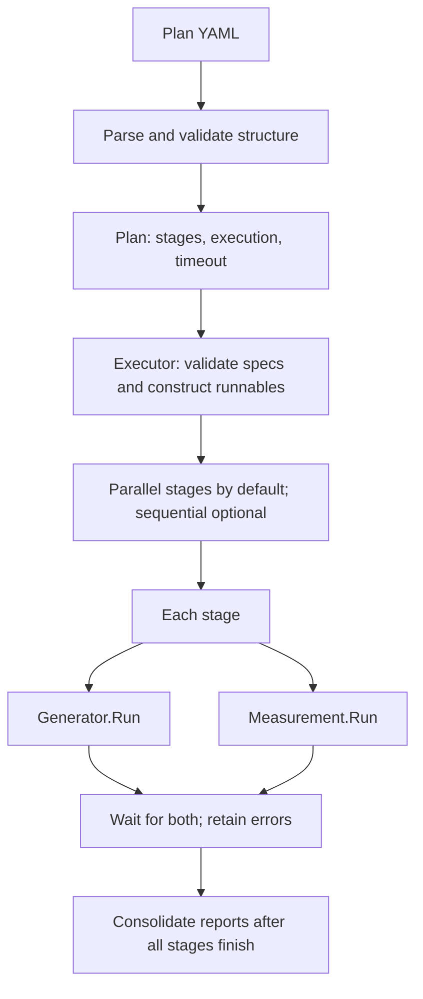

# Scale Tests

Plan-driven testing of NKTP correctness and capacity under telemetry load.
The harness runs no-op components without a cluster, or finite binary workloads
through the Kubernetes Job generator. **Measurements currently support only no-op.**
Successful Job execution does not verify backend delivery or NKTP performance.

## Local cluster

Requires Docker, Kind, kubectl, Helm, and Task. From the repository root:

```sh
task scale:up
task scale:down
```

`scale:up` creates `nktp-scale` with the [dedicated Kind config](kind-config.yaml)
if needed, then installs or upgrades the NKTP Helm release in namespace `nktp`
from the local chart. It prepares chart dependencies and waits for nodes and NKTP
workloads, including workloads created by the Operator. Each readiness wait has a
five-minute timeout. Workload readiness does not verify telemetry delivery.
Chart dependencies are downloaded only when missing or invalid.

Use `HELM_VALUES_FILE=/absolute/path/to/values.yaml` to supply Helm values.
Relative paths are resolved from `tests/scale/`. Each run applies the current
chart defaults and the supplied values file. Pass the file on every run that
needs it. Omitting it restores chart defaults. Tilt is not required.

Run `scale:up` again to apply local chart or values changes to the existing
cluster. Kind configuration changes require `scale:down` followed by `scale:up`.
Failed setup leaves the cluster for inspection. After correcting the problem,
retry `scale:up` or run `scale:down` followed by `scale:up` for a fresh cluster.

Scale commands use only `tests/scale/.kubeconfig` and the `kind-nktp-scale`
context. For manual access:

```sh
export KUBECONFIG="$PWD/tests/scale/.kubeconfig"
```

`scale:down` deletes the scale cluster and its kubeconfig. It does not stop the
dev Tilt session or delete the dev cluster. The no-op plans below do not require
`scale:up`.

## Domain model

| Concept | Meaning |
| --- | --- |
| `Plan` | Named configuration with a timeout, execution mode, and ordered stages. |
| `Stage` | Unique name and one generator/measurement pair. The pair runs concurrently. |
| `ComponentSpec` | Implementation `type` and its implementation-specific `spec`. |
| Generator | Runnable responsible for the complete generation lifetime and resource cleanup. |
| Measurement | Runnable that produces findings and returns an error if execution or checks fail. |
| `measurements.Report` | Measurement-owned structured findings; an empty report is valid. |
| `PlanReport` | Run ID, plan name, and stage reports with component errors, in declaration order. |

The plan contains configuration, not executable objects. `Executor` validates
every component specification and constructs fresh runnables before any stage
starts. Generators support `type: noop` and `type: job`. Measurements support
`type: noop`. No-op components accept an empty or omitted `spec` and return
ordinary success and empty measurement reports. This does not evaluate NKTP
correctness or performance.



## Basic configuration

The following plan runs two independent stages concurrently:

```yaml
name: harness-smoke
execution: parallel
timeout: 1m
stages:
  - name: baseline
    generator:
      type: noop
      spec: {}
    measurement:
      type: noop
      spec: {}
  - name: second-stage
    generator:
      type: noop
      spec: {}
    measurement:
      type: noop
      spec: {}
```

This example is available at [plans/noop.yaml](plans/noop.yaml). Omitted
`execution` defaults to `parallel`. Set it to `sequential` to finish each stage
before starting the next; the generator and measurement still run concurrently
within each stage. A positive `timeout` and unique, nonempty stage names are
required. Unknown envelope fields, duplicate keys, and multiple YAML documents
are rejected by the parser. Implementation names and specs are checked by the
executor before any runnable starts.

## Running

From the repository root, run the telemetrygen plan against the default scale
Kind cluster:

```sh
task scale:up
task test:scale -- -plan "$PWD/tests/scale/plans/telemetrygen.yaml"
task scale:down
```

The default kubeconfig is `tests/scale/.kubeconfig`, created by `scale:up` for
context `kind-nktp-scale`. To use another cluster:

```sh
task test:scale KUBECONFIG=/absolute/path/to/kubeconfig -- -plan "$PWD/tests/scale/plans/telemetrygen.yaml"
```

Override the default with the Task variable `KUBECONFIG` before `--`, an
environment variable, or `-kubeconfig PATH` after `--`. The forwarded form
`-plan PATH KUBECONFIG=/absolute/path/to/kubeconfig` also works. A trailing
assignment takes precedence over `-kubeconfig`, which overrides the Task or
environment default. Prefer absolute paths for overrides. Relative paths
resolve from `tests/scale`. Kubeconfig file lists are rejected.

No-op plans do not require a kubeconfig or cluster:

```sh
task test:scale
task test:scale -- -plan "$PWD/tests/scale/plans/noop.yaml"
```

Or from `tests/`:

```sh
go test -tags scale -count=1 -v -timeout=5m -run '^TestRun$' ./scale
go test -race -tags scale -count=1 ./...
```

`tests/scale/main_test.go` is the build-tagged entrypoint. It loads the plan and
calls `runner.Executor.Execute`. Plan paths are absolute or relative to
`tests/scale`, the Go test's working directory. The executor uses Go's default
`slog` logger to log each stage's completion and then the plan's completion, with
plan name, run ID, and errors. Consolidated stage reports are logged by the test
after execution. Any returned error fails the test and command.

## Execution and extension

The [pkg](pkg) directory contains the `runner` Go package within `tests/go.mod`.
`plan.go` owns configuration and parsing; `executor.go` owns consumer-defined
runnable interfaces, scheduling, and consolidated reports. `components.go` selects
constructors and delegates spec validation to them.

Concrete generators live in [pkg/generators](pkg/generators), and concrete
measurements live in [pkg/measurements](pkg/measurements). Each package's `noop.go`
provides a `Noop` implementation, a `NewNoop` constructor, and private spec
validation as the example for future implementations: validate the spec before
returning a runnable, without acquiring resources.

`measurements.Report` holds the measurement's findings; `StageReport` and
`PlanReport` stay with the executor. Both implementation packages satisfy the
executor's interfaces without importing the runner package. `main_test.go`
imports `tests/scale/pkg` as `runner`.

A component error cancels its peer in the same stage. Other stages continue,
including later sequential stages. Successful completion does not cancel a peer.
Plan timeout or caller cancellation stops active work and prevents unstarted
components from running. Their report entries contain cancellation errors.
Partial reports are retained, and report order is independent of completion order.

Every runnable must honor its context and finish its goroutines and bounded
cleanup before returning, including after partial startup. The executor waits
for these returns; cancellation cannot forcibly stop an uncooperative runnable.
Constructors must acquire no resources. Measurements must finish modifying their
reports before returning them.

The harness can be extended with additional generators and measurements.

## Available generators

- **No-op (`noop`)** exercises the harness without generating load or requiring a
  cluster. See the [no-op plan](plans/noop.yaml).
- **Kubernetes Job (`job`)** runs a containerized load generator to completion.
  See the [telemetrygen plan](plans/telemetrygen.yaml) for configuration.

The telemetrygen plan uses namespace `nktp` and the NKTP services installed by
`task scale:up`. When using another cluster, adjust the plan namespace and
endpoints as needed. The test harness itself does not provision a cluster.

**Jobs and pods are cleaned up before the test returns**, including after failure
or cancellation. Workload and cleanup errors fail the test.
